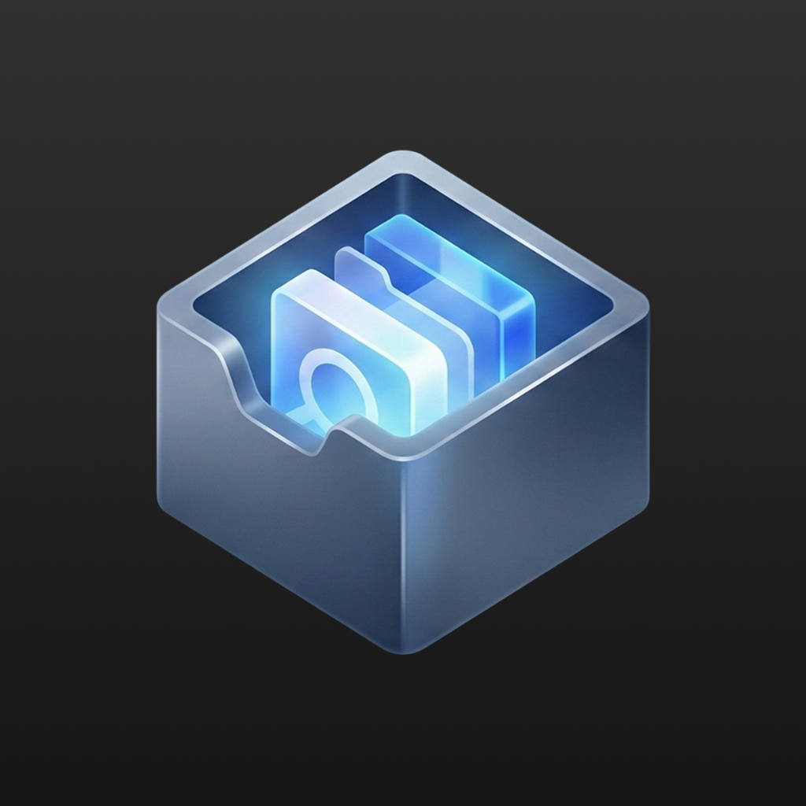
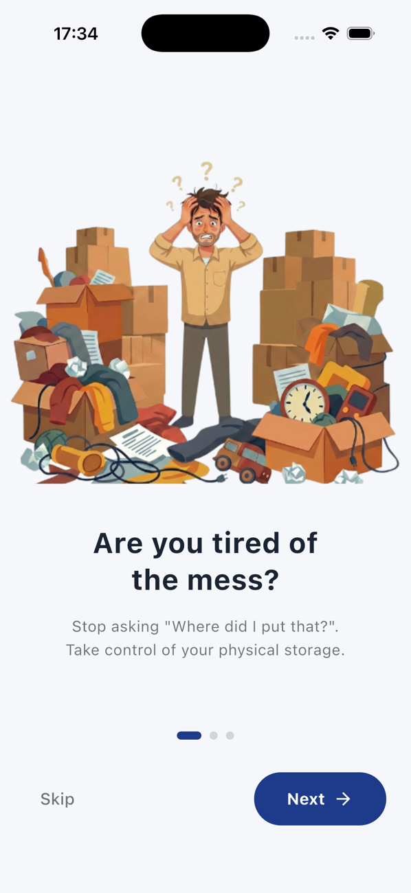
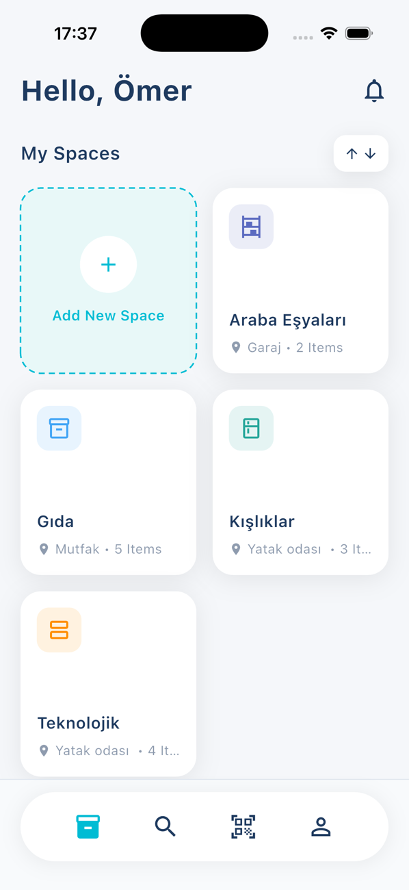
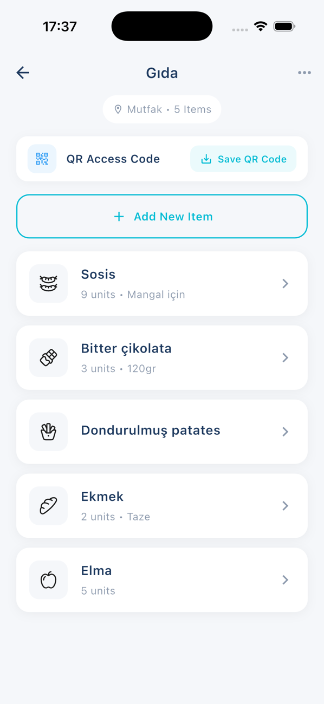
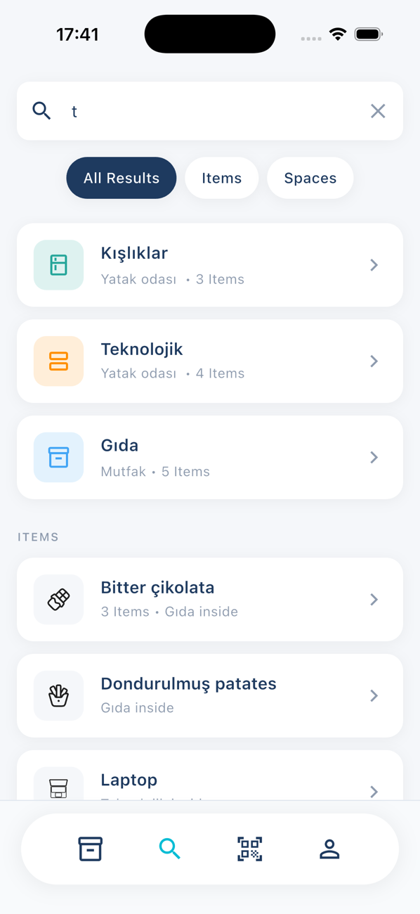
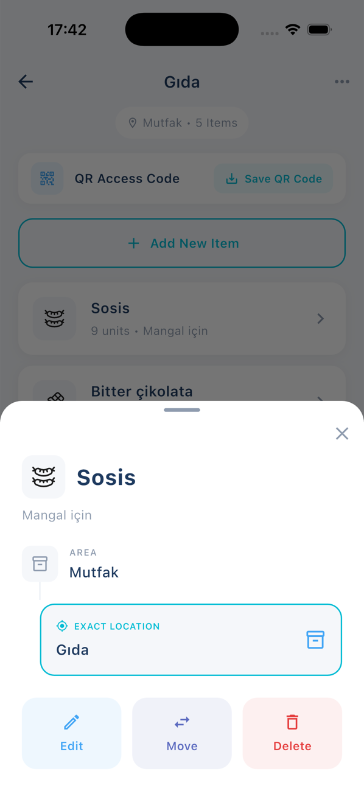

<div align="center">



# Inventra

**Your personal inventory manager — know what you own and exactly where it is.**

Label a box, drawer, shelf or cabinet with a QR code, scan it, and see everything inside without opening it.


</div>

---

## Overview

Inventra is a cross-platform mobile app built with Flutter and Firebase that turns physical storage into a searchable digital inventory.

Every storage space you create gets its own QR code. Stick the code on the box, and from then on a single scan opens its contents. A global search covers every item in every space, so "where did I put that?" takes a few seconds to answer.

## Screenshots

<p align="center">
  
  
  
  
  
</p>

## Features

**Storage spaces**
- Create spaces of four types: box, drawer, shelf and cabinet, each with a name and a location.
- Sort spaces by name or by item count.
- Rename, relocate or delete a space. Deleting a space removes its items in the same batch.

**Items**
- Add items with a quantity, a description and a note.
- Give each item its own icon from a library of 500+ SVG icons in eight categories (food, electronics, clothes, hobby & art, hygiene & health, kitchen, stationery, tools).
- Edit, delete or move an item to another space.

**QR codes**
- Each space has a unique QR code generated in the app.
- Save the code to the photo gallery to print it as a label.
- Scan a code with the built-in scanner (with flashlight toggle) to jump straight to that space.

**Search**
- Search across all spaces and items at once, with filters for all results, items only or spaces only.

**Accounts and sync**
- Sign in with email and password or with Google.
- Email verification, password reset, password change with live strength validation, "remember me", and account deletion.
- Data is stored per user in Cloud Firestore and updates in real time.

**Experience**
- Light, dark and system themes.
- English and Turkish localization.
- Onboarding flow, animated splash screen and skeleton (shimmer) loading states.

## Tech stack

| Area | Technology |
| --- | --- |
| Framework | Flutter (Dart SDK `^3.7.0`), Material Design |
| State management | `provider` (`ChangeNotifier`) |
| Authentication | Firebase Authentication, Google Sign-In |
| Database | Cloud Firestore |
| QR | `qr_flutter` (generation), `mobile_scanner` (scanning) |
| Device | `permission_handler`, `gal`, `path_provider`, `shared_preferences` |
| UI | `flutter_svg`, `shimmer` |
| Localization | `flutter_localizations`, `intl`, ARB files |

## Architecture

The code is organized feature-first, with shared building blocks in `core`.

```text
lib/
├── main.dart               # Firebase init, provider setup
├── app.dart                # MaterialApp, theming, localization, tab navigation
├── core/
│   ├── providers/          # Auth, storage, theme and app state
│   ├── services/           # Firebase Auth and Firestore access
│   ├── theme/              # Colors, light and dark themes
│   ├── utils/              # Auth error mapping
│   └── widgets/            # Reusable UI components
├── features/
│   ├── auth/               # Login, sign-up, password flows
│   ├── home/               # Storage space overview
│   ├── storage/            # Create, manage and view a space
│   ├── item/               # Add item, item detail sheet
│   ├── scanner/            # QR scanner
│   ├── search/             # Global search
│   ├── profile/            # Account, appearance, language, help, about
│   ├── onboarding/
│   └── splash/
├── models/                 # Space, Item
└── l10n/                   # English and Turkish strings
```

Screens talk to providers, providers talk to services, and only services touch Firebase. Writes that affect more than one document (adding, deleting or moving an item while keeping the space's item count correct) run as Firestore batch writes.

### Data model

```text
users/{uid}
└── spaces/{spaceId}            name, location, type, itemCount, createdAt
    └── items/{itemId}          name, quantity, description, note, iconPath, createdAt, updatedAt
```

Firestore security rules restrict every document under `users/{uid}` to the signed-in user with that UID.

## Getting started

### Prerequisites

- [Flutter SDK](https://docs.flutter.dev/get-started/install) with Dart 3.7 or later
- Xcode (for iOS) or Android Studio (for Android)
- A Firebase project with **Authentication** (Email/Password and Google providers) and **Cloud Firestore** enabled

### Run the app

```bash
git clone https://github.com/omerfarukeroglu/Inventra.git
cd Inventra
flutter pub get
```

Connect the app to your own Firebase project:

```bash
dart pub global activate flutterfire_cli
flutterfire configure
```

Then run it on a connected device or simulator:

```bash
flutter run
```

The QR scanner needs a camera, so test scanning on a physical device.

## Author

**Ömer Faruk Eroğlu**

- GitHub: [@omerfarukeroglu](https://github.com/omerfarukeroglu)
- LinkedIn: [omerfaruk-eroglu](https://www.linkedin.com/in/omerfaruk-eroglu/)
